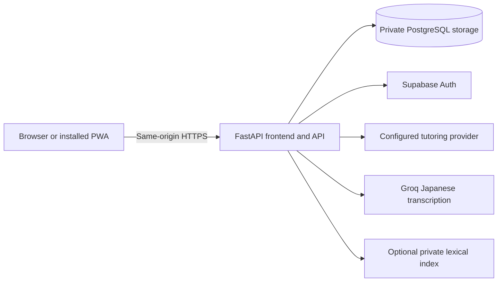

# Architecture

This is the durable source of truth for GoiGrow's current architecture. Topic
documents describe algorithms and operational contracts in more detail; private
development journals are not architecture specifications.

## Runtime and request flow

`app/main.py` constructs the application, shared HTTP client, services and route
handlers. `app/config.py` loads settings from the repository-relative private `.env`
with process environment overrides. FastAPI serves the static frontend, account
pages, manifest and root service worker. The client uses native DOM rendering,
hash navigation and relative API paths; there is no separate frontend host or
browser Supabase SDK. Use one application worker: conversational caches, request
coordination and rate/concurrency limits include process-local state.

## Learning services and evidence

| Boundary | Responsibility | Detailed reference |
|---|---|---|
| `app/assessment/` | Validated item bank, adaptive selection, scoring, completion | [Placement](assessment-design.md) |
| `app/learner/` | Current profile, preferences, topics, events and saved exchanges | [Learning memory](learning-memory.md) |
| `app/curriculum/` | Deterministic topic/difficulty/time planning; cached activity content | [Curriculum](curriculum-design.md) |
| `app/mastery/` | Evidence normalization and separate knowledge/confidence estimates | [Mastery](mastery-design.md) |
| `app/review/` | FSRS adapter, due queues, rating policy, concurrency and replay | [Reviews](review-design.md) |
| `app/conversation/` | Scenario lifecycle alongside existing saved tutor sessions | [Features](features.md#tutor-and-conversations) |
| `app/jlpt/` | Authored bank, selection, scoring and transactional session recovery | [JLPT](jlpt.md) |
| `app/audio_progress/` | Validated listening/speaking/voice events and bounded summaries | [Features](features.md#audio-practice) |

Application-owned schemas validate model output before persistence. A model cannot
choose account ownership, arbitrary topics, final skill levels, mastery values,
review dates or database mutations. Performance, exposure, assistance and unavailable
evaluation remain distinct. Idempotency keys, submission fingerprints, optimistic
versions and transactions keep retries from duplicating evidence or losing progress.

## Persistent storage

`AssessmentRepository` and `app/storage.py` form the shared storage boundary.
Development uses SQLite; the deployed system uses the existing Supabase PostgreSQL
database through a backend-only TLS connection. Application tables live in
`tutor_private`, outside the browser Data API. Supabase-managed identity tables
remain in `auth`; no second learner store or password database exists.

| Stored information | Main tables |
|---|---|
| Placement definitions, state and immutable result | `assessment_questions`, `assessments`, `assessment_answers`, `learner_profiles` |
| Current learner state and evidence | `learner_state`, `skill_state`, `learning_topics`, `learner_topics`, `mistake_state`, `learning_events`, `skill_history` |
| Saved tutor and scenario state | `tutor_sessions`, `conversation_turns`, `conversation_states` |
| Study plans and activities | `study_sessions`, `study_activities` |
| Knowledge estimates and due reviews | `mastery_evidence`, `topic_mastery`, `mastery_history`, `review_schedules`, `review_attempts` |
| JLPT practice | Learner-owned session/question/answer tables in `app/jlpt/migrations.py` |
| Access and accounts | `staging_resources`, `account_sessions`, `account_beta_members`, `account_learner_links` |

Audio progress reuses `learning_events` rather than storing raw audio. Optional
knowledge tables (`knowledge_meta`, `knowledge_sources`, `knowledge_chunks`,
`knowledge_postings`) hold derived private reference material, not learner identity.

The application learning schema is version 8. Additive startup migrations preserve
existing records; unknown versions and staging initialization failures fail closed.
Auth/session, learner-association and optional knowledge schemas have separate
initialization/migration boundaries. Association-table migration is an explicit
operator operation, not something a documentation update or client request performs.

## Identities, accounts and restoration

These are separate identities:

- Shared staging access permits entry to the private application.
- A signed `tutor_staging` cookie identifies a legacy browser ownership context.
  `staging_resources` records its authorized resources.
- A learner identity owns its placement, preferences and learning history.
- A Supabase account identity is verified independently through the backend.
- An opaque application session identifies a particular authenticated browser.
- `account_learner_links` can associate one account with one existing learner.

An identifier in a URL, request or local storage is a selection hint, never proof
of ownership. The backend rechecks resource and descendant ownership in the storage
boundary. Linked records use account authorization; historical staging ownership
must not become an alternative way to access them.

The current deployment supports approved-account sign-in but keeps learner linking
disabled. Signing in does not create, claim, merge, replace or restore a learner.
The implemented linking boundary requires a valid ready session, recent authentication,
server-resolved original ownership evidence, an unambiguous eligible learner,
explicit confirmation and transactional uniqueness checks. Failures or ambiguity
must not silently choose a profile. Private operational evidence stays outside Git.

Changing hostname, browser, device or installed iOS app can create a separate cookie
and storage context. Users independently sign in in each context; original progress
is not assumed restored until account-to-learner restoration is explicitly verified.
See [security](security.md) and [deployment](deployment.md).

## Providers and audio

`LLMProvider.generate` isolates Gemini, Groq and OpenAI transport details. The factory
can wrap Gemini with the bounded Groq fallback when configured. Tutor, evaluation
and generated study content use this same boundary. See [provider design](provider-design.md).

The browser owns Japanese TTS and temporary microphone capture. Transcription is
an explicit upload to the backend, which validates WAV bytes and forwards Japanese
audio to Groq. Raw recordings are not permanently stored. Speaking feedback operates
on confirmed text; voice conversation remains turn-based. [Feature details](features.md).

Optional knowledge retrieval uses bounded lexical lookup and untrusted context,
with no vector service or automatic document ingestion in the web process.
See [knowledge operations](knowledge.md).

## Client caching and PWA

The manifest uses relative start URL `/#home` and scope `/`. The worker caches only
three versioned public offline resources: offline HTML, its stylesheet and an icon.
It does not provide offline lessons, accounts or saved progress. Protected HTML,
APIs, conversations, learner records, recordings and transcripts remain network-only.
Asset fingerprints and lazy route scripts reduce repeat downloads without adding
another client data store. See [security](security.md#pwa-and-browser-storage).
